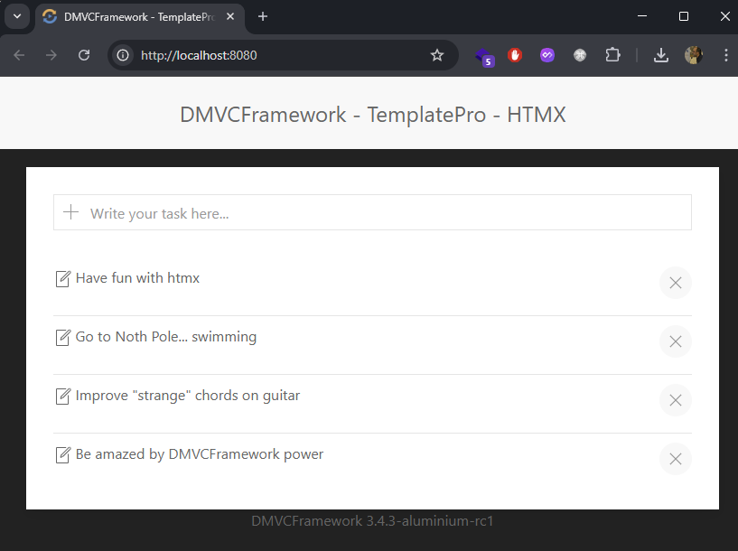

# Delphi-HTMX-Todo

A small **Todo** web application showing [htmx](https://htmx.org/) support in
[DMVCFramework](https://github.com/danieleteti/delphimvcframework): partial page
updates with **no JavaScript** on the page, just server-rendered HTML fragments.

It uses:
- [DMVCFramework](https://github.com/danieleteti/delphimvcframework) 3.5.x — Delphi MVC web framework (wizard-style layout)
- [htmx](https://htmx.org/) — partial page updates without JavaScript
- [TemplatePro](https://github.com/danieleteti/templatepro) — server-side template rendering
- MVCActiveRecord — ORM for database operations
- SQLite (via FireDAC) — storage

[My Blog](https://www.danieleteti.it)

Tested on MS Windows but it should work also for Linux.

### Screenshot

## Features

- Create, edit (inline), and delete todos — all via htmx partial swaps, no full reloads.
- Click a todo to edit it inline; press **Enter** to save or **Esc** to cancel.
- **Server-side validation**: a todo `content` cannot be empty and is capped at
  200 characters (declarative `[MVCRequired]` / `[MVCMaxLength]` validators on
  the entity → HTTP `422` on violation), mirrored by client-side `maxlength`.
- **Anti mass-assignment**: the server-assigned `id` is annotated with
  `[MVCDoNotDeserialize]`, so a POST/PUT body cannot inject or overwrite it.
- **Delete confirmation** via `hx-confirm` on the delete button.
- **Graceful error UX**: client-side `hx-validate` + `required` prevent empty
  submits in the browser; server errors render a themed UIKit error page for
  browser navigations (details hidden unless `dmvc.error.show_details` is set)
  and RFC 7807 problem+json for API clients.
- **Security headers**: Content-Security-Policy (CDN origins allow-listed),
  `X-Frame-Options: DENY`, `Referrer-Policy`, `nosniff`; `X-Powered-By` disabled.
- **ETag + gzip** on responses; colored console log plus a rotating file log in
  `bin/logs/`.
- **Reproducible database**: the SQLite file and schema are created at startup
  from `bin/schema.sql` if missing — no binary database needs to be shipped.

## Project layout

| File | Role |
|------|------|
| `delphitodohtmx.dpr` | Console entry point — `Boot` (dotEnv, LoggerPro, profiler), SQLite bootstrap, `TMVCServerFactory.CreateIndyDirect` (native Indy, no WebBroker) |
| `EngineConfigU.pas` | `ConfigureEngine`: controllers, TemplatePro view engine, filters (static files, security headers + CSP, ETag, compression, ActiveRecord), exception handler |
| `BootConfigU.pas` | `Boot`: dotEnv configuration, LoggerPro console+file appender, profiler |
| `Controllers.MainU.pas` | REST endpoints (htmx-driven) |
| `Entities.TodoU.pas` | `TTodo` ActiveRecord model with validation |
| `FDConnectionConfigU.pas` | SQLite connection definition + `EnsureSqliteDatabase` |
| `bin/.env` | Configuration (port, view path, view cache, request size, ...) |
| `bin/schema.sql` | Database schema, applied at startup if needed |
| `bin/templates/home.html` | Main page layout (add form + list) |
| `bin/templates/todo/_item.html` | Single todo item fragment (partial update) |
| `bin/templates/todo/_form.html` | Inline edit form fragment |
| `bin/templates/_baselayout.html` | Base layout (UIKit CSS/JS, htmx, error handler) |
| `bin/templates/error.html` | Browser error page served by `UseExceptionHandler` |

## How it works

The controller checks `Context.Request.IsHTMX` in `OnBeforeAction` and sets
`ViewData['ispage']`. The base layout renders the full HTML page only for regular
browser requests; for htmx requests it renders just the requested fragment.

| Method & path | Action | Returns |
|---------------|--------|---------|
| `GET  /`            | list all todos       | `home` page or `#todoItems` partial |
| `POST /add`         | create a todo        | `todo/_item` (appended to the list) |
| `GET  /edit/:id`    | edit form for a todo  | `todo/_form` (swaps the row) |
| `PUT  /edit/:id`    | update a todo        | `todo/_item` (replaces the row) |
| `DELETE /delete/:id`| delete a todo        | empty body (removes the `<li>`) |
| `GET  /todos/:id`   | single todo fragment | `todo/_item` (used by Esc-cancel) |

Missing ids return `404`; an empty or over-long `content` returns `422` (validation).
Note the framework's default `Content-Type` is `application/json` (REST-first):
this server-side-view app forces `text/html` in the engine config.

## Build & run

This is a Delphi project — it requires the Delphi IDE or the command-line
compiler (Delphi 11 Alexandria or newer; developed with Delphi 13 Florence).
DMVCFramework 3.5.x sources are expected on the library path.

1. Open `delphitodohtmx.dproj` in the IDE and build, or from the command line:
   `rsvars.bat` from the Delphi `bin` folder, then
   `msbuild delphitodohtmx.dproj /p:Config=Debug /p:Platform=Win64`.
2. Run the executable from the `bin/` directory (it loads `.env` and templates
   from there). The server defaults to **port 8080**
   (`dmvc.server.port` in `bin/.env`) and listens with the native Indy server:
   press `CTRL+C` to shut it down.
3. Navigate to `http://localhost:8080`.

On first run the app creates `bin/todo.db` from `bin/schema.sql` if it does not
already exist, so a fresh checkout runs out of the box.

## Configuration

All runtime knobs live in `bin/.env` (loaded via `dotEnv`):

| Key | Default | Meaning |
|-----|---------|---------|
| `dmvc.server.port`              | `8080`  | HTTP listen port |
| `dmvc.view_path`                | `templates` | TemplatePro view folder |
| `dmvc.view_cache`               | `false` | Cache server-side views (use `true` in production) |
| `dmvc.max_request_size`         | `10000` | Max request body size in bytes |
| `dmvc.profiler.enabled`         | `true`  | Enable request profiling |
| `dmvc.profiler.warning_threshold`| `2000` | Log requests slower than this (ms) |
| `dmvc.error.show_details`       | `false` | Show exception messages on the error page (development only) |
| `dmvc.expose_x_powered_by`      | `false` | Emit the `X-Powered-By` header |

## License

See the DMVCFramework repository for licensing terms.
